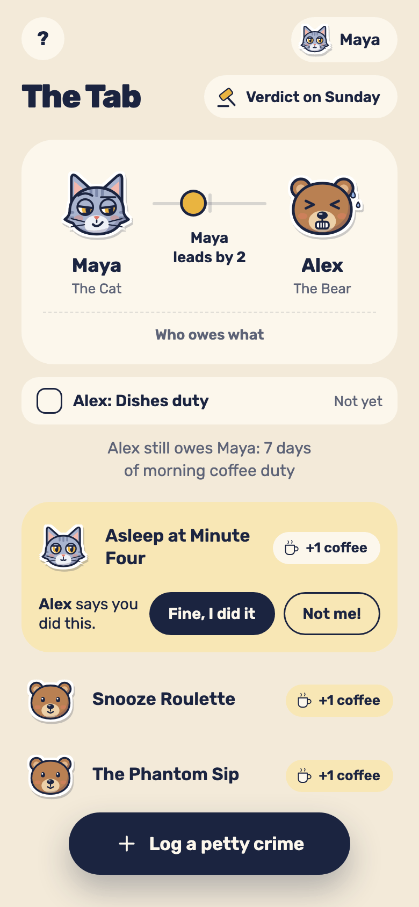
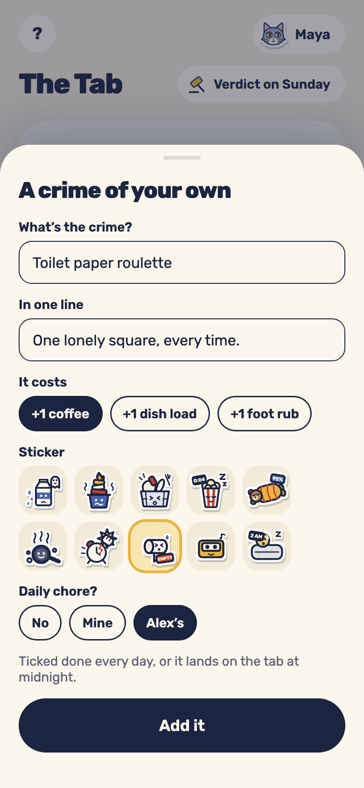
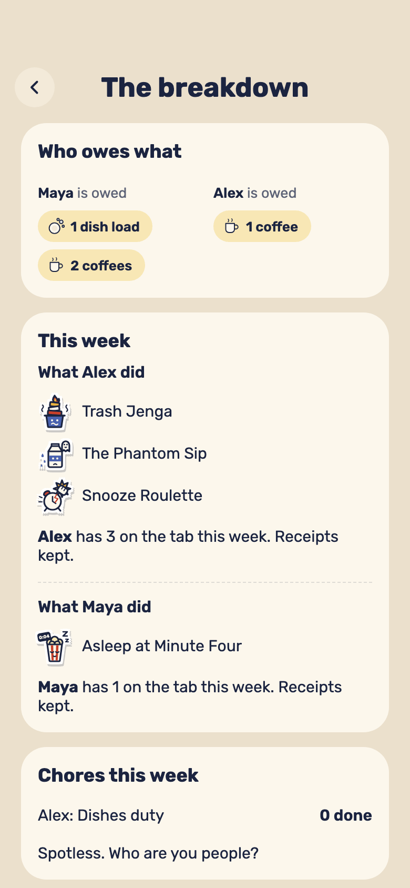
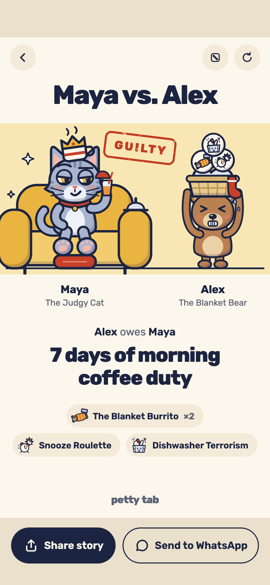
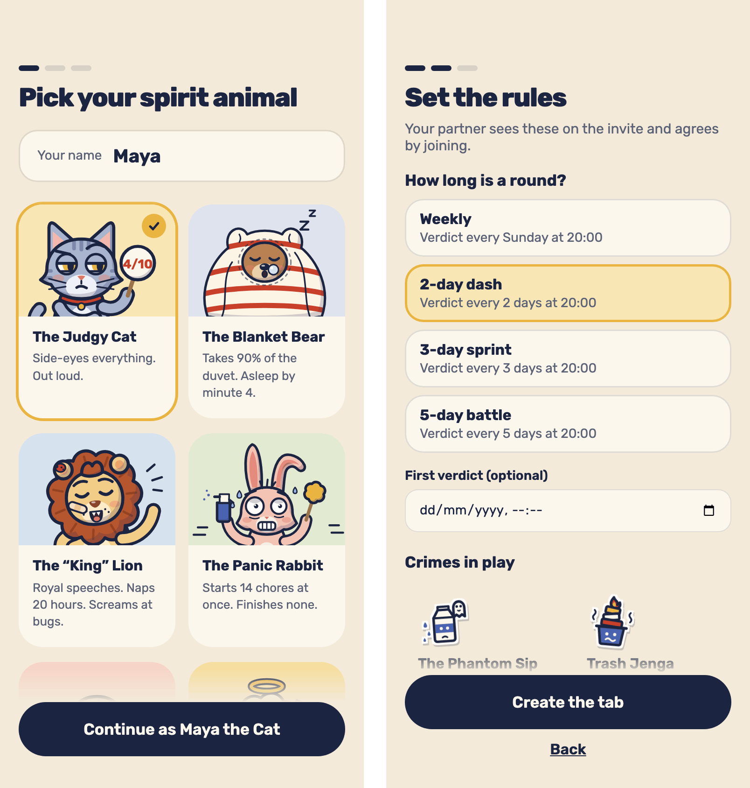
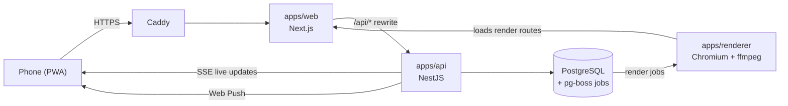

<div align="center">

# Petty Tab ⚖️🐱🐻

**The playful court and chore ledger for couples, roommates and best friends.**

Log each other's petty crimes all week. When the round ends, the court seals a verdict: the guilty party owes
the winner a funny sentence, served up as a story card and a 6-second reel.

[](https://github.com/raday146/petty-tab/actions/workflows/ci.yml)


[](LICENSE)

<br>

<table>
  <tr>
    <td align="center"></td>
    <td align="center"></td>
    <td align="center"></td>
    <td align="center"></td>
  </tr>
  <tr>
    <td align="center"><sub>The tab</sub></td>
    <td align="center"><sub>Your own crimes and chores</sub></td>
    <td align="center"><sub>The breakdown</sub></td>
    <td align="center"><sub>The verdict</sub></td>
  </tr>
</table>

</div>

## How a round plays

1. **File it.** Your partner drank the last of the milk and put the carton back? Tap **Log a petty crime** and
   pick "The Phantom Sip". Every crime adds one unit of a silly currency (a coffee, a dish load, a foot rub) to
   what they owe you. Undo works for 10 seconds.
2. **Plead.** The accused answers on their own phone: **Fine, I did it**, or **Not me!** to appeal. An appeal
   stops counting until the filer upholds it. Say nothing for 24 hours and it counts as guilty.
3. **The verdict.** When the round ends, the court seals it. Whoever was charged more is found **GUILTY** and
   owes the winner a sentence ("7 days of morning coffee duty"). Can't wait? Both of you tap **Settle now**.
   The next round starts at 0–0.

## Features

- **Set the rules before you invite.** A three-step setup: pick your name and one of nine spirit animals, set
  the rules, then share the invite link. Your partner sees your animal and the rules, accepts them, and picks
  their own animal.

  

- **Rounds of any length.** Weekly (Sunday 20:00), a 2-day dash, a 3-day sprint or a 5-day battle, plus an
  optional date and time for the first verdict. You can also agree to move the current deadline together.
- **Your own crimes and daily chores.** Add crimes in your own words, with a sticker and a price. Make one a
  daily chore for either of you: a day it isn't ticked lands on the tab at midnight.
- **The breakdown.** Who owes what, each side's crimes this round, chores done and neglected, past verdicts and
  the all-time score, with commentary that keeps the receipts.
- **Made to share.** Every verdict renders as a 9:16 story card (PNG) and a 6-second reel (MP4) with sound, ready
  for Instagram Stories or WhatsApp.
- **Feels like an app.** Install it to your home screen. Web Push tells you when you've been charged, pleaded
  or sentenced. Updates are live, sound effects and haptics come with every tap, and you get a clear screen
  when you're offline.
- **No accounts.** No sign-up and no passwords. Your phone keeps an anonymous session, and the invite link
  pairs the two of you.
- **Ready for Hebrew.** Names in Hebrew and English sit correctly side by side, and the layout is built for a
  right-to-left interface later.

## Architecture

A pnpm workspaces monorepo. Domain rules live in one place, `packages/shared`, as pure, unit-tested
functions: scoring, round windows, verdicts and pleas. The API enforces them; the web app imports them for
instant feedback.

```
apps/web          Next.js App Router + Tailwind: the screens, the PWA shell, the in-app reel preview
apps/api          NestJS + Prisma: REST, Server-Sent Events, the sealing job, Web Push
apps/renderer     worker: headless Chromium (Playwright) + ffmpeg turn verdicts into card PNGs and reel MP4s
packages/shared   domain types, zod schemas, crime and sentence catalogs, scoring and time maths
packages/art      the nine animals, stickers and scenes as SVG builders
packages/reel     the reel timeline (pure data + a React player), shared by the preview and the renderer
```



- **Jobs and cron:** pg-boss runs on the same Postgres (no Redis). Every 5 minutes the sealing job seals each
  round whose deadline has passed. It is idempotent, so sealing twice is a no-op.
- **Time:** stored in UTC. Each pair has an IANA timezone, and round boundaries are computed in it, daylight
  saving included. A clock is injected everywhere so tests can travel in time.
- **Renders:** one timeline, two outputs. The renderer steps the reel frame by frame with `seek(t)`, renders the
  audio offline and muxes with ffmpeg.
- **Identity:** an httpOnly session cookie holding a random id that is stored hashed. Invite tokens are 128-bit,
  hashed, single use. IDs are UUIDv7.

| Area | Choice |
| --- | --- |
| Web | Next.js 16 (App Router), React 19, Tailwind CSS 4, TypeScript 6 |
| API | NestJS 12, Prisma 7, PostgreSQL 18, zod |
| Jobs | pg-boss 12 |
| Renders | Playwright Chromium, ffmpeg |
| Tests | Vitest (unit), Playwright (end-to-end and screenshot comparison) |
| Runtime | Node 24, pnpm 12, Docker Compose, Caddy |

## Run it locally

You need Node 24 (via nvm), Docker, and ffmpeg on your `PATH` for the renderer. pnpm comes from Corepack.

```bash
nvm use && corepack enable pnpm   # Node 24 from .nvmrc; pnpm version from packageManager
cp .env.example .env              # before the first install: prisma generate reads DATABASE_URL
pnpm install
docker compose up -d db           # Postgres only
pnpm db:migrate                   # apply the Prisma migrations
pnpm dev                          # web on :3000, API on :3001, renderer in watch mode
```

Open http://localhost:3000. The web app proxies `/api/*` to the API, so everything runs on one origin. To try
it as a pair, open a second browser profile or a private window for your partner.

### Tests

```bash
pnpm lint && pnpm typecheck       # ESLint + Prettier check, tsc in every package
pnpm test                         # Vitest across packages (the API tests need the db up and migrated)
pnpm --filter @petty-tab/web exec playwright install chromium   # once
pnpm e2e                          # Playwright end-to-end and screenshot comparison
```

The README screenshots come from the same harness, with demo data:

```bash
SHOWCASE=1 pnpm e2e e2e/showcase.spec.ts   # raw captures into docs/assets/screenshots/
```

The spec's header comment lists the ffmpeg steps that compose and compress them.

## Deploy

`compose.prod.yaml` runs the whole stack on one server: Postgres, the API, the web app, the renderer, Caddy
(automatic HTTPS for `$DOMAIN`) and a backup service.

```bash
cp .env.example .env              # set DOMAIN, POSTGRES_PASSWORD and the keys listed in .env.example
docker compose -f compose.prod.yaml up -d --build
```

Migrations run when the API starts. Every night at 03:00 UTC the backup service dumps the database and the
render storage, restores the dump into a scratch database to prove it works, and keeps the last 14
(`ops/backup.sh`). The full runbook (keys, restore, upgrades, the uptime check) is in
[`docs/plan.md`](docs/plan.md), milestone M7.

## Docs

| | |
| --- | --- |
| [`docs/spec.md`](docs/spec.md) | Product rules, data model and API |
| [`docs/design.md`](docs/design.md) | Tokens, type, components, every screen |
| [`docs/reel.md`](docs/reel.md) | The 6-second reel, frame by frame, with audio cues |
| [`docs/plan.md`](docs/plan.md) | Milestones, their "done when" checks, and the deploy runbook |
| [`reference/`](reference/) | The approved prototype and the visual targets the screenshot tests compare against |

## License

The code is released under the [MIT License](LICENSE).

The character artwork, illustrations and any audio assets in `packages/art/` and `assets/` are not covered by
the MIT License. They remain Copyright © 2026 Shlomo Raday, all rights reserved; see [LICENSE](LICENSE).
